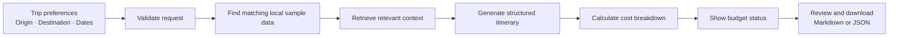
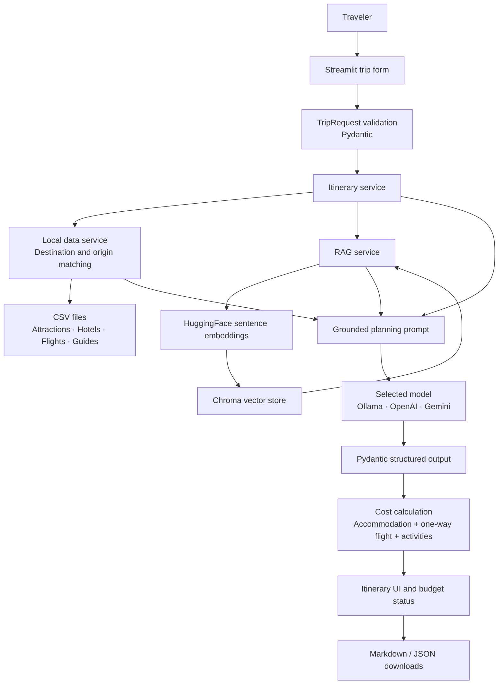

# GenAI Travel Itinerary Planner

## Client presentation overview

**Project type:** Demonstration travel-planning application  
**Primary user:** A traveler planning a multi-day trip  
**Application:** Streamlit web app  
**Status:** Functional prototype using illustrative local data and an LLM; it does not book travel

> **Important:** This prototype demonstrates itinerary planning and estimated-cost workflows. Its bundled travel records are sample data, not verified recommendations, live prices, schedules, inventory, or bookable travel.

## 1. Executive summary

The GenAI Travel Itinerary Planner turns a traveler's starting city, destination, dates, budget, group size, interests, travel pace, and accommodation preference into a structured day-by-day itinerary.

It combines:

- A guided trip-request form with input validation.
- Administrator-provisioned user accounts with sign-in and logout; public signup is disabled.
- Local CSV travel records for attractions, accommodation, routes, and destination guidance.
- Retrieval-augmented generation (RAG) to provide relevant local context to the language model.
- A selectable language-model provider: Ollama, OpenAI, or Gemini.
- A structured itinerary response with cost categories and budget comparison.
- Markdown and JSON downloads.

The application is designed to demonstrate the planning experience. It does **not** connect to live travel inventory, verify sample prices, or make reservations.

## 2. What the traveler does

1. Enters a **starting location** and a different **destination**.
2. Selects trip dates, budget and currency, number of travelers, accommodation preference, interests, and travel pace.
3. Submits the request. The app validates dates and rejects matching origin and destination cities.
4. The app looks for destination-matched sample data and, when supplied, a route matching the starting city.
5. A selected language model creates the structured itinerary using the request and available context.
6. The app calculates the available sample cost estimates, displays the total and any budget overage, and allows Markdown or JSON export.

### User journey



**Validation outcomes:** If the starting city and destination are the same, the form shows a concise validation message. If no destination-matched attraction records exist, the app stops generation and explains that local data is missing rather than asking the model to invent an itinerary.

## 3. How the application works



### In plain language

- **The form** collects the traveler's requirements.
- **Validation** catches invalid dates and a same-city journey before generation.
- **Local data lookup** finds records that match the destination and, for sample flights, the starting city.
- **RAG** searches the local knowledge collection for text that may help answer the trip request.
- **The language model** drafts the itinerary in the application's expected structure.
- **The application code** calculates the displayed accommodation, flight, and activity totals and compares that total with the proposed budget.
- **The export feature** lets the traveler save the result for review.

## 4. Cost estimate explained

The displayed total is calculated by the application as:

```text
Estimated trip total
    = estimated accommodation
    + estimated one-way flights (when a matching sample route is available)
    + estimated itinerary activities
```

### Components

- **Accommodation:** selected sample nightly rate × number of nights × estimated rooms. The current room assumption is one room per two travelers, rounded up.
- **Flights:** lowest matching sample one-way fare in the selected currency × number of travelers. The estimate is only for the one-way route represented by the sample data; it is not a round-trip fare.
- **Activities:** the activity costs returned in the itinerary. The application does not lower these costs just to make the total appear within budget.
- **Budget status:** if estimated costs exceed the proposed budget, the app displays the full estimate, the difference over budget, and the accommodation / flight / activity breakdown.
- **Unavailable sample flight:** if there is no matching route or fare in the local sample data, the app displays a message and calculates a total excluding flights. This does not establish that no real-world flight exists.

### Costs not currently included

Meals, ground transportation, taxes, baggage, insurance, visa fees, and other incidental costs are not included unless explicitly represented in an itinerary activity. The displayed estimate is therefore not a complete quote for a real trip.

## 5. Current capabilities and boundaries

| Area | Available in this prototype | Not provided |
|---|---|---|
| Access | Administrator-provisioned accounts, sign-in, and logout | Public signup or saved trip history |
| Trip request | Origin, destination, dates, budget, currency, travelers, interests, pace, accommodation preference, and notes | Persisted trip history |
| Input checks | Date ordering and same-city origin/destination validation | Geocoding or authoritative city/airport resolution |
| Itinerary | Structured, day-by-day LLM-generated plan | Guaranteed factual accuracy or operational feasibility |
| Local data | CSV-backed attractions, hotel estimates, flight samples, and destination guides | Verified or comprehensive destination coverage |
| Flight estimate | Matching one-way sample fare multiplied by travelers | Live search, round-trip pricing, seat inventory, or booking |
| Accommodation estimate | Sample nightly rate, nights, and room-count assumption | Live rates, availability, taxes, or booking |
| Budget handling | Full calculated estimate and explicit over-budget comparison | Guarantee that every real trip expense fits the budget |
| Export | Markdown and JSON | Booking vouchers or supplier confirmations |
| Model provider | Ollama, OpenAI, or Gemini selection | A guarantee that providers return identical results |

## 6. Data quality and responsible demonstration

The bundled files are intended to demonstrate the application's data flow:

- The CSV `source` fields identify records as illustrative or synthetic where applicable.
- The attractions and destination-guide files contain synthetic test fixtures. Application context preparation excludes records marked synthetic/test data so they are not offered as real recommendations.
- The flight file includes synthetic routes and fares. These records are not evidence that a route operates and are not live fares.
- Hotel records are illustrative and do not represent real properties or availability.
- The LLM prompt directs the model not to invent destination facts or fill missing information from general knowledge.
- Destination coverage checks prevent itinerary generation when destination-matched attraction data is missing.

For a client demonstration, describe these as **sample estimates**. Before a production deployment, replace them with properly licensed and verified data, authoritative source references, and live supplier integrations as needed.

## 7. Suggested client demo script

1. **Introduce the use case:** “A traveler provides the trip constraints once and receives a draft itinerary to review.”
2. **Enter a supported destination:** Choose a starting city and a different destination represented in the sample attraction data.
3. **Show personalization:** Set dates, travelers, budget, interests, pace, and accommodation preference.
4. **Generate the plan:** Explain that local CSV data and retrieved text are supplied to the selected model.
5. **Review the estimate:** Point out the separate accommodation, flight, and activity amounts. If the total exceeds budget, show the overage and its reasons.
6. **Demonstrate a guardrail:** Enter the same city for origin and destination and show the concise validation message.
7. **Demonstrate data coverage:** Try a destination with no attraction records and explain that the prototype declines to invent destination recommendations.
8. **Export:** Download the itinerary as Markdown or JSON.
9. **Set expectations:** Reiterate that the demo uses unverified sample data and does not search live inventory or book services.

## 8. Glossary

| Term | Client-friendly explanation |
|---|---|
| **Generative AI (GenAI)** | AI that creates new text—in this app, a draft itinerary—from a request and supplied context. |
| **Large language model (LLM)** | The text-generating AI service selected for an itinerary request. |
| **Prompt** | Instructions and trip details sent to the model to guide its response. |
| **Structured output** | A response organized into defined fields, such as trip summary, daily plans, activities, and costs, instead of free-form text only. |
| **Pydantic validation** | Programmatic checks that user input and model output follow expected field types and rules. |
| **Retrieval-augmented generation (RAG)** | A workflow that retrieves relevant text from a local knowledge collection and supplies it to the model as context. |
| **Embedding** | A numerical representation of text used to find content with related meaning. |
| **Vector store** | A database that stores embeddings and supports similarity search; this prototype uses Chroma. |
| **Grounding** | Providing reference material to constrain model output. Grounding reduces unsupported answers but does not guarantee truth. |
| **Synthetic test data** | Artificial records used to test software behavior; they are not real places, routes, prices, or travel guidance. |
| **Estimate** | An indicative calculation based on the available sample inputs—not a quote, confirmed price, or promise. |
| **Provider** | The selected model service: Ollama (local), OpenAI, or Gemini. |

## 9. Technical overview

- **User interface:** Streamlit
- **Application language:** Python
- **LLM integration and prompt pipeline:** LangChain
- **Data validation and structured itinerary models:** Pydantic
- **Local tabular data:** CSV files read with pandas
- **Semantic retrieval:** HuggingFace sentence-transformer embeddings and Chroma
- **Export formats:** Markdown and JSON
- **Tests:** pytest

The default provider is configured for Ollama. OpenAI and Gemini can be selected when their API credentials and configuration are supplied through environment settings. Credentials should be kept out of source control.

## 10. Recommended next steps for a production-ready service

1. Replace all synthetic and illustrative data with verified, source-linked records.
2. Integrate authorized flight, accommodation, maps, and local transport providers.
3. Add round-trip selection, fare conditions, taxes, baggage, and a documented cost scope.
4. Record data timestamps, currency, source, and expiry for every quote.
5. Add user authentication, saved plans, privacy controls, and operational monitoring.
6. Add broader quality checks for factual grounding, budget arithmetic, route validity, and itinerary timing.
7. Obtain client approval before any future booking workflow; booking actions should require explicit user confirmation.

## 11. One-minute project summary

> “This is a GenAI travel-planning prototype. A traveler enters a starting point, destination, dates, budget, group size, and preferences. The app validates the request, looks up destination-matched local sample data, retrieves relevant context, and asks a selected language model for a structured itinerary. It then calculates available sample accommodation, one-way flight, and activity estimates, compares the result with the proposed budget, and exports the plan. The bundled information is illustrative—not live or bookable—and the app does not make reservations.”
